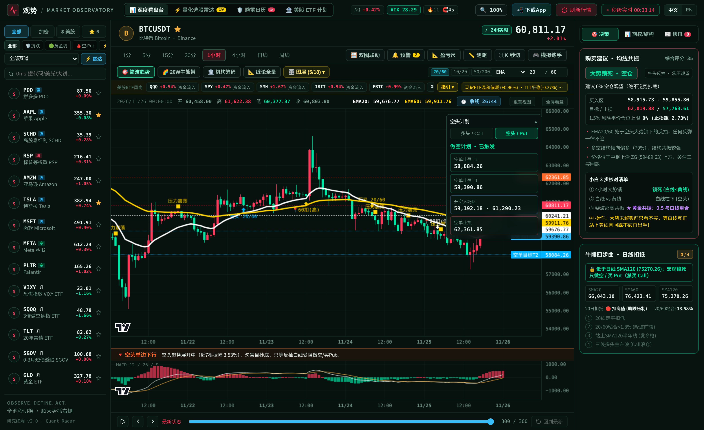
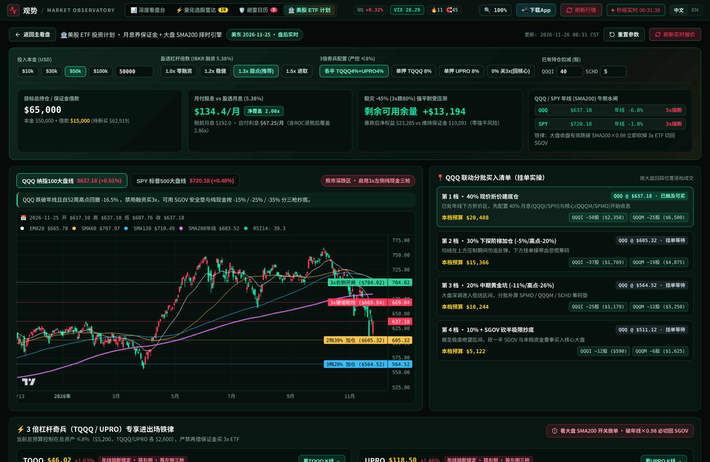
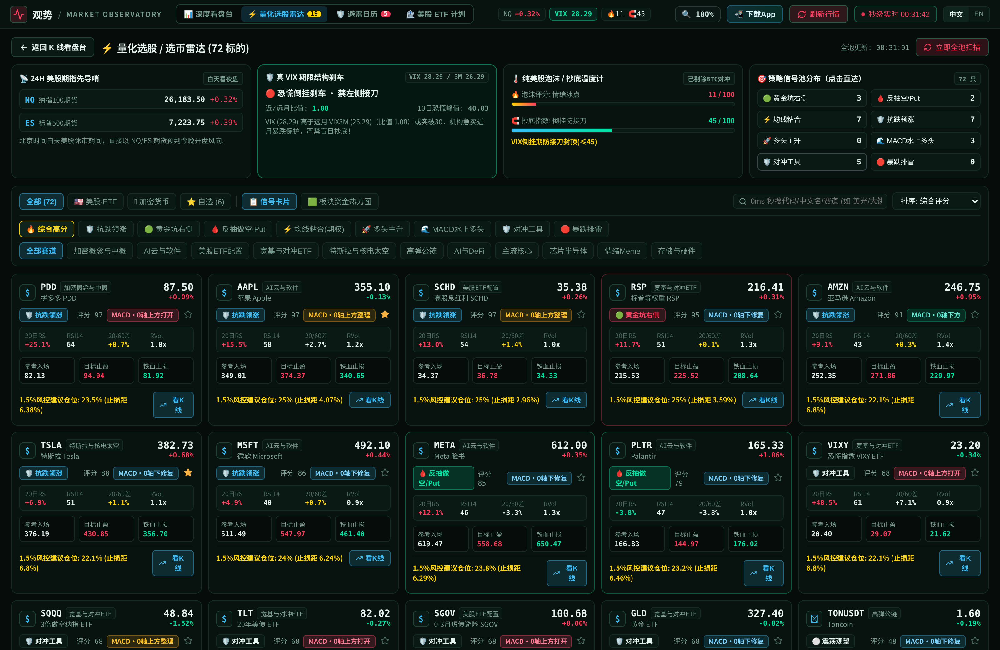

<div align="center">

<h1>📈 观势 · Market Observatory</h1>

<p>
  <strong>零 API Key 开箱即用 · 美股全天候（盘前 / 盘中 / 盘后）& 加密货币实战看盘终端</strong><br/>
  <sub>自研双均线扣抵 · 20W 牛熊支撑带 (EMA20+MA20) · 缠论全自动结构 · VPVR 筹码峰 & FVG 机构缺口 · 均线穿越 Telegram 自动推送 · 美股 ETF 1.3x 保证金实盘</sub>
</p>

<p>
  <a href="https://github.com/stanlll-cloud/market-observatory/releases/latest">
    
  </a>
  <a href="https://github.com/stanlll-cloud/market-observatory/stargazers">
    
  </a>
  <a href="#-方式一docker-一行命令跑通推荐自部署">
    
  </a>
  <a href="#-方式二免安装桌面端直接下载-windows--macos">
    
  </a>
  <a href="LICENSE">
    
  </a>
</p>

<br/>



<br/>
<br/>

**[🐳 30 秒 Docker 启动](#-方式一docker-一行命令跑通推荐自部署)** · **[📥 下载 Win / Mac 客户端](#-方式二免安装桌面端直接下载-windows--macos)** · **[📡 均线穿越 Telegram 推送](#-均线穿越自动推送telegram--webhook)** · **[🏦 美股 ETF 计划](#-核心模块全景)**

</div>

---

## 💡 为什么做「观势」？（告别高价会员费与拼凑脚本）

市面上很多看盘工具和开源仓库要么靠收费墙锁住 VPVR/多图联动，要么自建前先逼你申请五六个付费 API Key。**观势**把专业买方交易员每天真正高频用到的分析引擎全部本地化、开源化，**0 注册、0 付费订阅、0 第三方数据 Key**：

| 核心能力 | **观势 · Market Observatory** | TradingView (Plus/Premium) | 常规开源行情看板 (如 OpenStock 等) | Finviz Elite |
| :--- | :---: | :---: | :---: | :---: |
| **启动门槛（API Key / 数据库）** | **✅ 0 Key 开箱即用（免建库）** | 需登录账号 | 需自配 MongoDB + Finnhub + 多家付费 Key | 需付费订阅 |
| **美股盘前 / 盘中 / 盘后真实报价** | **✅ 1 分钟成交槽位实时抽取** | 需额外买盘前盘后包 | 免费版通常仅小时级或延迟 | 延迟/收费 |
| **均线穿越自动推送（TG / Webhook）** | **✅ 免费不限条数 · 支持 ±% 偏移** | 收费墙限制预警数量 | 依赖 Inngest + Gmail | 仅邮件且收费 |
| **20W 牛熊支撑带 (`EMA20+MA20`)** | **✅ 一键切换 + 红/绿云带 + 拐头判断** | 需手动写 Pine 脚本 | ❌ 无 | ❌ 无 |
| **筹码峰 VPVR + 机构缺口 FVG + 吸筹** | **✅ 全部免费内置 · 自动裁剪回补** | 需 Essential/Plus 会员 | ❌ 无（仅嵌官方 iframe） | ❌ 无 |
| **缠论全自动（笔 / 线段 / 中枢 / 背驰）** | **✅ 纯 Python 毫秒级实时绘制** | ❌ 无 | ❌ 无 | ❌ 无 |
| **均线扣抵 + 64+ 标的雷达 + VIX 结构** | **✅ 一键联动 1.5% 风险平价仓位** | ❌ 无 | 部分基础热力图 | 仅有筛选器 |
| **美股 ETF 月息养保证金 + 股灾压测** | **✅ QQQ/SPY 年线开关 + 3x 进出场表** | ❌ 无 | ❌ 无 | ❌ 无 |

---

## 🚀 30 秒极速启动（三种任选）

### 🐳 方式一：Docker 一行命令跑通（推荐自部署）

无需在本机配置 Python、Node 或 MongoDB，拉起即用，数据与预警规则自动持久化在本地 `./data` 目录：

```bash
git clone https://github.com/stanlll-cloud/market-observatory.git
cd market-observatory

# （可选）如需开启 Telegram / Webhook 均线穿越自动推送，复制并填写 .env：
cp .env.example .env

docker compose up -d
```

启动后浏览器直接打开 **`http://localhost:8766`** 即可看盘（默认内置全市场实时报价与极简 1 行工具栏）。

---

### 📥 方式二：免安装桌面端直接下载（Windows / macOS）

已将完整的 **FastAPI 量化计算引擎 + Lightweight Charts 前端** 打包进本地应用，行情直连本机网络，无任何第三方中转或数据收集：

| 平台 | 安装包 | 说明 | 下载链接 |
| :--- | :--- | :--- | :--- |
| 🪟 **Windows 10 / 11** | `MarketObservatory-Win64.exe` | 单文件绿色版，双击即开独立看盘窗口（`Ctrl +` / `-` 缩放） | [点击下载 Win64.exe](https://github.com/stanlll-cloud/market-observatory/releases/latest/download/MarketObservatory-Win64.exe) |
| 🪟 **Windows 便携包** | `MarketObservatory-Windows-x64.zip` | 含 `.exe` + 源码启动脚本 `start_windows.bat` + 说明文档 | [点击下载 Win64.zip](https://github.com/stanlll-cloud/market-observatory/releases/latest/download/MarketObservatory-Windows-x64.zip) |
| 🍎 **macOS (Apple Silicon)** | `MarketObservatory-Mac.dmg` | 原生 `WKWebView` 桌面壳，支持 `⌘1/2/3/4` 秒切视图与无极缩放 | [点击下载 Mac.dmg](https://github.com/stanlll-cloud/market-observatory/releases/latest/download/MarketObservatory-Mac.dmg) |

> **系统首次运行放行提示**：
> - **Windows**：若出现 Microsoft Defender SmartScreen 提示，点 **「更多信息」→「仍要运行」** 即可。
> - **macOS**：将 `观势 Market Observatory` 拖入 `Applications`，首次打开若提示未公证，**右键点击 App →「打开」** 即可永久放行；也可在顶部菜单栏 `数据线路` 接入你自己的云端实例。

---

### 🛠️ 方式三：本地 Python 源码运行

- **Windows**：安装 Python 3.10+ 后直接双击根目录 **`start_windows.bat`**。
- **macOS / Linux**：

```bash
git clone https://github.com/stanlll-cloud/market-observatory.git
cd market-observatory
python3 -m venv .venv && source .venv/bin/activate
pip install -r backend/requirements.txt

# 仓库已附带编译好的 frontend/dist，直接启动后端即可：
cd backend && uvicorn main:app --host 127.0.0.1 --port 8766
```

---

## 📡 均线穿越自动推送（Telegram / Webhook）

彻底告别盯盘焦虑！点击主工作台工具栏 **`🔔 预警` → `📡 均线穿越自动推送`**：

- **内置 4 个实战策略一键模板**：
  - `QQQ 破 SMA200×0.98`（3x 杠杆 ETF 硬止损熔断 → 切回 `SGOV` 避险）
  - `QQQ 站 SMA200×1.03`（确认有效突破年线 → 右侧顺风开闸）
  - `BTC 穿日线 EMA20`（加密趋势生命线突破/跌破双向提醒）
  - `任意标的 20W 牛熊带`（周线 `EMA20 + MA20` 突破预警）
- **自定义规则**：支持任意美股/ETF/加密币种、`1h / 4h / 1d / 1w` 周期、`EMA / MA(SMA)`、`20/50/60/100/120/200` 均线以及 **±% 偏移触发线**。
- **免重启网页直配通道**：直接在预警抽屉的 `⚙️ 通道配置` 中填入你的 `Telegram Bot Token + Chat ID` 或 Discord / 飞书 / Bark `Webhook URL`，点击 **`📨 测试推送`** 秒验证。

---

## 🖼️ 核心模块全景

### 1. 极简实战主工作台 · 4 大场景一键切换 + 3-Tab 决策面板
- **一键场景预设栏**：把 18 个专业分析图层收进 4 个高频按钮——**`🎯 简洁趋势`**（默认清爽看盘）、**`🌈 20W牛熊带`**（周线 `EMA20 + MA20` 红/绿云带 + 自动拐头诊断）、**`🏛️ 机构筹码`**（`VPVR + FVG + 主力吸筹 + VWAP`）、**`📐 缠论全量`**（自动笔/线段/中枢/背驰三买卖）。
- **右侧 3-Tab 聚焦视图**：**`🎯 决策`**（购买建议 · 均线共振 + 牛熊四步曲日线扣抵）、**`📊 期权/结构`**（期权买卖建议 + 多空偏向 + 结构概览 + 相似历史样本）、**`📰 快讯`**（实时市场快讯与半小时重大突发高亮）。
- **全套专业工具**：双图多周期联动、`📐 盈亏尺 + 1.5% 风险平价仓位计算`、`📏 Shift+点击测距`、`⌘K` 全局命令面板、`🎮 $100,000` 模拟练手盘。

### 2. 🏦 美股 ETF 实盘配置与 `QQQ / SPY` 年线择时页 (`?view=etf_plan`)



- 针对 `$50,000` 本金 + IBKR Pro `1.30x` 温和融资场景建模（支持自定义本金、杠杆率、已有持仓 `QQQI`/`SCHD` 扣减），实时计算 **`QQQI + SPYI + SGOV` 月息对账（覆盖 `2x+` 保证金利息）** 与 **`-45%` 股灾维持保证金防强平安全余量**。
- 内置 **`QQQ` / `SPY` 2 年日线 K 线 + `SMA200` 牛熊水闸**，按当前牛熊水位自动切换右侧均线低吸或左侧折价阶梯挂单清单，并给出 **`TQQQ` / `UPRO`** 右侧解锁与左侧纯现金三枪买点。

### 3. ⚡ 72 标的量化雷达 & VIX 期限结构 (`?view=radar`) + 🛡️ 避雷日历 (`?view=calendar`)



- **量化雷达**：一次性并发扫描美股七巨头、AI 算力半导体、核心 ETF 与主流加密资产，内置 **`VIX / VIX3M` 期限结构防接刀闸门** 与 **Finviz 风格板块资金热力图**。
- **避雷日历**：自动过滤噪音数据，精筛 FOMC、CPI、核心 PCE、非农等重磅宏观事件北京时间倒计时，以及未来数日财报 IV Crush 预警。

---

## 📈 Star History

<div align="center">
  <a href="https://www.star-history.com/#stanlll-cloud/market-observatory&Date">
    
  </a>
</div>

---

## 🌐 跨境看盘线路 & 赞助支持

> **国内网络开箱说明**：行情数据直连 **Binance**、**Yahoo Finance** 与 **Nasdaq**。工作台后端已内置**本地代理端口自动探测与死端口跳过**（自动识别 Clash `7890/7897`、V2RayN `10808/10809`、`1087` 等常见端口），本地开启代理后无需改任何配置即可秒刷。

同时提醒：**请勿使用来路不明的公共免费万人节点登录盈透证券 (IBKR)、嘉信理财、Binance 或 OKX**，IP 频繁漂移极易触发异地风控。

- **✈️ 自用稳定跨境看盘专线 — 搬瓦工官方自营 Just My Socks**
  👉 [https://justmysocks.net/members/aff.php?aff=39372](https://justmysocks.net/members/aff.php?aff=39372)
  - 电信 CN2 GIA / 联通 AS9929 专线回程，美股开盘冲刺不丢包；支持 IP 异常自动无缝切换。
- **🖥️ 24H 私有云端中枢方案 — 搬瓦工 BandwagonHost VPS**
  👉 [https://bandwagonhost.com/aff.php?aff=85048](https://bandwagonhost.com/aff.php?aff=85048)
  - 配合上方 Docker Compose 部署在海外 VPS 上，内存占用仅 `~60MB`；手机打开网页或通过右上角「📲 下载App」安装 **iOS 全屏桌面书签**，无需本地代理随时直连看盘。

如果这个项目帮你省下了每年几百美元的行情会员费，欢迎点亮右上角 **⭐ Star**，也欢迎提交 PR 一起完善更多量化因子！

---

## ⚠️ 免责声明

本项目所有均线、缠论结构、20W 牛熊带、VPVR 筹码分布、FVG 缺口、均线推送及 ETF 仓位测算**仅作为个人量化技术分析与盘面复盘辅助工具**，不构成任何投资、期货、期权或保证金交易建议。市场有风险，交易盈亏自负。
